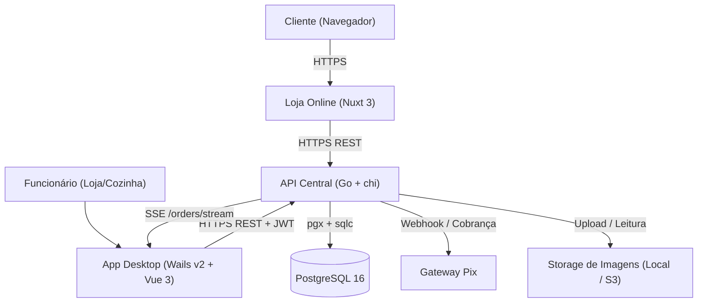

# Arquitetura do Sistema

Este documento resume a arquitetura de alto nível do sistema. A especificação detalhada do domínio e do roadmap encontra-se em [ARQUITETURA.md](../ARQUITETURA.md).

## Visão de Contêineres

## Decisões Arquiteturais

Consulte o índice de ADRs em [docs/adr/README.md](./adr/README.md).
